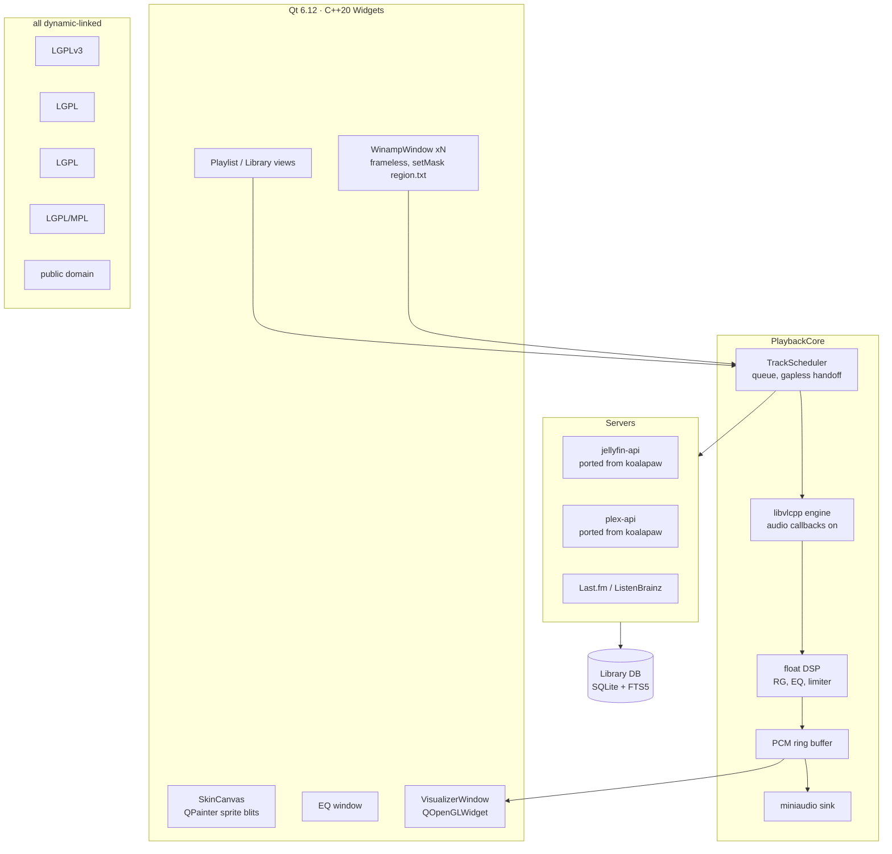

# KoalaAmp — Feasibility Study

*"KoalaAmp" is the working name (2026-10-10). Handle and name searches came back clean — no GitHub org/repos, no npm/PyPI package, koalaamp.com unregistered, no existing product with the exact name — but it must survive the formal RL-1 trademark check (soft note: elf audio's "Koala Sampler" is an established adjacent-category music app; different word form/category, low confusion risk, but search-before-launch). Project formerly nicknamed "JellyAmp" — that name cannot ship (§6.3: Jellyfin discourages `Jelly[word]`).*

A clean-room, Win/macOS/Linux music player in the spirit of classic Winamp: full **classic skin** compatibility, MilkDrop visualisations, a 10-band equaliser, local library, plus **Plex** and **Jellyfin** server integration. **UI stack: Qt 6 (C++/Widgets).**

**Stack decision (recorded 2026-10-10):** Qt 6 was selected after an Avalonia-vs-alternatives review (`research/frameworks.md`). The deciding fact: classic Winamp's weird shapes are **window masks** (`region.txt` polygons → `SetWindowRgn`/XShape), not per-pixel transparency, and Qt is the only mainstream framework with a first-class mask API (`QWidget::setMask`). Alternatives ranked in `research/frameworks.md`: Electron+Webamp (fastest-to-fidelity, but one-overlay window model + Chromium maintenance profile), Avalonia+native-shims (mask-vs-GPU-swapchain interaction unproven), Flutter (rejected — no masks, experimental multi-window). Rationale and evidence in §1a.

Research date: 2026-10-10. Full evidence: `docs/research/*.md` (skins, visuals, audio, platform, servers, formats, frameworks). Every load-bearing claim below cites those reports.

---

## 1. Verdict

**Feasible — GO.**

- **Classic Winamp 2 skins (WSZ), the 10-band EQ, MilkDrop presets, local library, Jellyfin, and Plex are all demonstrably achievable** with permissively-licensed or LGPL components and documented formats. Every subsystem has at least one working, shipping precedent — several *on Qt itself* (Qmmp, Audacious Qt UI, projectM's own Qt frontend).
- **The skin-fidelity mechanism now matches the original.** Qt gives us real OS masks on Windows (`SetWindowRgn`, verified in `qwindowswindow.cpp`) and X11 (XShape), and CALayer shape masking on macOS (verified in `qcocoawindow.mm` — see §1a for the honest nuance). This is the mechanism Winamp itself used; no alpha-substitution on the primary platforms.
- **Scope correction carried over:** "full compatibility with Winamp's skin system" cannot mean Winamp 5 **modern (WAL) skins with Maki scripting** at v1. That is a multi-year sub-project (Maki VM + ~65-class script API + XML layout engine). v1 ships **classic 2.x skin compatibility** — the format the 100k+ museum corpus overwhelmingly uses, and the one every modern reimplementation implements. Modern skins remain an explicit Phase 3 gamble.
- **AVS is out of v1, honestly.** Winamp's other visualizer format is a 32-bit-Windows binary-plugin ecosystem. The practical target is **MilkDrop via projectM** (LGPL, active, 10k+ preset corpus, *ships Qt frontends*).
- **Plex/Jellyfin risk is retired.** The maintainer owns production clean-room client code for both (`~/Code/koalapaw/koalapaw-androidtv`: hand-written `jellyfin-api` module — 285 Kotlin files, auth interceptor, QuickConnect, UDP discovery, music windows; `plex-api` module — plex.tv PIN flow, GDM discovery, playback/timeline). The Android code is a *port* job (Kotlin→C++ concepts are 1:1, the HTTP/JSON contracts are identical), not a research job.
- **Residual hard caveat (Linux):** native Wayland has **no output-shaping protocol at all** (xdg-shell exposes input regions only; confirmed in Chromium's `wayland_toplevel_window.cc` and Qt's Wayland platform). True masks work on X11 and **XWayland**; on native Wayland the app runs masked via alpha, and Qt clients cannot self-position windows (docking/snap needs XWayland there — the same tradeoff Audacious documents for its Winamp UI). Windows and macOS are unaffected.

### 1a. Why Qt (decision record)

| Requirement | Qt 6 answer | Evidence |
|---|---|---|
| region.txt polygon windows | `QWidget::setMask(QRegion)` — Windows: real `SetWindowRgn` (`qwindowswindow.cpp:3152`); X11: XShape; **macOS: `CAShapeLayer` mask on the view layer** (`qcocoawindow.mm:1324`) — CALayer-level clipping, not a native window region. Honest classification: on macOS it is the same *class* of technique as alpha masking (layer masking), but it yields exact polygon clipping (non-antialiased), which is all classic skins need — `region.txt` shapes are opaque polygons by construction | Qt 6.12 source, fetched 2026-10-10 |
| Input clipping (clicks fall outside shape) | Mask hints clip input on Windows/X11; macOS layer mask is visual-only → app-level hit-testing there (we do custom hit-testing anyway for sprite hot-areas) | Qt docs (`qwidget.html#setMask`); `qcocoawindow.mm` |
| No-compositor Linux | Masks are geometry — work on bare X11 with zero compositing | frameworks.md §0 |
| GPU visualizer | projectM is itself distributed with a Qt frontend; `QOpenGLWidget` hosting is the *supported* path (LGPL dynamic link) | projectM repo; frameworks.md §3 |
| Audio engine in-process | libvlc via libvlcpp (or QtMultimedia/FFmpeg — qtamp uses it); C++ all the way down, no IPC | frameworks.md §3 |
| Pixel-perfect bitmaps | `QPainter`, `SmoothPixmapTransform` off = exact nearest-neighbour; trivial | frameworks.md §3 |
| License | QtWidgets/QtGui/QtOpenGL are **LGPLv3** — dynamic linking keeps a closed app compliant (same discipline as VLC's own Qt frontend) | Qt licensing docs |
| Precedent | Qmmp + Audacious ship classic-skin players on Qt (GPL, study-only); qtWasabi proves pixel-exact Wasabi-era rendering on Qt6/Wayland/HiDPI | frameworks.md §2 |

Rejected alternatives and their reasons are in `research/frameworks.md` §11 (Electron+Webamp = runner-up; kept as documented fallback if the C++ skin engine stalls).

**The Wayland exception applies to everyone** (no framework can output-shape on native Wayland — it's protocol-absent), so it is not a Qt demerit; it is a documented platform limitation with an XWayland answer.

---

## 2. What "clean-room" means here (and the one rule that matters)

**The rule: no one on this project reads the 2024 Winamp source dump (or its mirrors), and no one reads GPL engine code with intent to port it.** The Winamp Collaborative License forbids forks and modified distribution; GPL'd reimplementation code (Qmmp, Audacious, qtWasabi's VM) would infect our license. All needed specs exist in independent, permissive sources.

| Source | Status | Use |
|---|---|---|
| Strider's classic-skin spec v1.2.1 (1998), WACUP Winamp-Skinning-Archive | Permissive community doc | Primary spec for classic skins |
| Webamp (MIT, 11.3k★) and winamp-eqf / winamp-skin parsers | MIT | Code may be *read and adapted* — behaviour oracle and coordinate table (`skinSprites.ts`) |
| Geiss's `vis.h` (BSD-3) | BSD | The literal ABI header, redistributable |
| projectM (LGPL-2.1+) | LGPL | MilkDrop engine — dynamically-linked shared library |
| projectm-eval (MIT) | MIT | ns-eel2 expression semantics reference |
| Butterchurn + milkdrop-preset-converter (MIT) | MIT | Differential-testing oracle for MilkDrop semantics |
| NDE readers: node-nde (MIT), xnde (GPLv3 — study only, don't copy) | Mixed | node-nde code readable; xnde spec doc only |
| Qmmp / Audacious / qtWasabi | GPL/BSD copyleft | **Off-limits for code**; behavioural reference for what a Qt skin engine must handle |
| **User's koalapaw `jellyfin-api` + `plex-api` (own work)** | **User's own clean-room code** | **Direct port base for server integration — the one place we own the provenance end-to-end** |
| Winamp 2024 source dump / WCL | Contaminated | **Never read** |
| Winamp 5.666 binaries | Proprietary | May be *run* to observe behaviour; code never decompiled |

**Provenance discipline (what the clean-room claim rests on):** (1) *no code or asset copying from Winamp* — nothing derives from the 2024 WCL dump or mirrors; (2) *MIT sources are read/adapted with attribution* (Webamp sprite tables and parsers, Butterchurn, projectm-eval); (3) *format facts that research cites to the pulled community-source mirror* (exact M3U writer emission, NDE field IDs, `classic_vis` 75-band behavior, EQ band tables) are used strictly as interoperability specs and are **cross-verified against independent permissive implementations** (Webamp, node-nde, VLC's own EQ table) before being relied on; (4) *GPL engines are behavioral references only*; (5) *LGPL components* (Qt, libvlc, projectM, TagLib) ship as dynamically-linked libraries with notices; (6) an audit script sweeps `resources/` for Nullsoft-derived assets and the PR checklist attests no-WCL/GPL consultation per contribution.

---

## 3. Component-by-component feasibility

| # | Subsystem | Feasibility | Anchor evidence |
|---|---|---|---|
| 1 | Classic WSZ skin engine | **Proven** — Webamp renders the corpus pixel-exact; format is a ZIP of BMPs + text configs, fully specified; Qmmp/Audacious prove it in Qt | skins.md §1-2 |
| 2 | Skin *semantics* (multi-window, snapping, windowshade, region.txt) | **Feasible** — Qt top-level windows + `setMask`; managed snapping service (XWayland on native Wayland) | frameworks.md §3; §1a here |
| 3 | Winamp 10-band EQ + preamp + presets (.eqf/.q1) | **Proven** — band table verified in VLC source; `.eqf` is a documented INI-ish format; biquads are textbook | audio.md §2.2, §3 |
| 4 | MilkDrop visualisations | **Proven** — projectM 4.1.8 (LGPL, active); ships Qt frontends; we feed PCM, it renders GL | visuals.md §3.1 |
| 5 | projectM embedded in Qt | **Low risk** — `QOpenGLWidget` hosting is the project-supported path (vs Avalonia's unproven ANGLE/GLES question) | visuals.md §6; frameworks.md §3 |
| 6 | AVS | **Not practical** — 32-bit APE DLL ecosystem; out of v1 | visuals.md §4.3 |
| 7 | Audio engine (decode) | **Proven** — libvlc 3.0.x via libvlcpp in-process (LGPL); FFmpeg inside covers FLAC/MP3/AAC/Opus/Vorbis/WavPack/APE/MPC/WAV | audio.md §2.2 |
| 8 | PCM tap + output sink | **Proven pattern** — libvlc audio callbacks (vmem/amem) deliver decoded PCM; **the user-filter chain (incl. equalizer) runs upstream of the callback** (verified in VLC source: `media_player.c:2231` sets `audio-filter`; `dec.c` builds the filter pipeline before the aout's `play`) — so in DSP mode we must *not* enable libvlc's EQ to avoid double-EQ; output via miniaudio (public-domain/MIT-0, single-file, WASAPI/CoreAudio/ALSA/Pulse) | VLC source, fetched 2026-10-10; miniaudio README |
| 9 | Gapless + ReplayGain | **Feasible, client-side** — no server or engine does it for us; pre-buffer next track, apply RG in the float pipeline | servers.md §1.6/§3.2-3.3 |
| 10 | Local library | **Proven** — TagLib 2.3.2 (LGPL/MPL, native C++, covers ID3/Vorbis/MP4/FLAC/APE/MPC/WavPack + tracker files); SQLite + FTS5 | taglib.org; audio.md §6-7 |
| 11 | Winamp data migration | **Proven** — NDE read-only importer (documented field IDs 0-41); winamp.ini/q1/bm import; M3U/PLS/B4S/XSPF | formats.md §1-3 |
| 12 | Jellyfin client | **Solved** — port the user's koalapaw `jellyfin-api` (auth, discovery, QuickConnect, music windows); MediaBrowser auth scheme already handled there | koalapaw code; servers.md §1 |
| 13 | Plex client | **Solved** — port the user's koalapaw `plex-api` (PIN/link auth, GDM, playback/timeline); remaining risk is upstream API churn, now a maintenance task not a research task | koalapaw code; servers.md §2 |
| 14 | Modern skins (WAL + Maki) | **Long-term stretch** — Maki bytecode documented (Webamp); VM feasible; class-library binding is the multi-year part | skins.md §2; formats.md §8 |

---

## 4. Recommended architecture (summary — full detail in SPEC.md)

Decisions:
- **Qt 6.12 LTS (C++20, Widgets)**; QML explicitly rejected — classic skins are a fixed-coordinate bitmap problem, and Widgets give the closest mental model (Qmmp/Audacious precedent). One `QWidget` subclass per Winamp window.
- **libvlc decodes; our pipeline owns output.** Audio callbacks (vmem) hand us decoded (and, if enabled, native-EQ'd) PCM → our float DSP (EQ/ReplayGain/limiter) → miniaudio sink; a ring buffer feeds projectM and the main-window spectrum with the *same post-DSP samples*. **In DSP mode we never call `libvlc_media_player_set_equalizer`** (the user-filter chain runs upstream of the callback — verified in VLC source — so native EQ *would* apply; enabling it would double-EQ). Bit-perfect is an opt-in that bypasses DSP, uses libvlc's own aout, and visibly disables spectrum/vis.
- **Library = SQLite + FTS5**, schema modelled on Winamp's NDE field list (import becomes a column mapping).
- **Skins render through one `QPainter` path** at integer scale; `Qt::SmoothPixmapTransform` off; `region.txt` polygons → `setMask` (Windows/X11) with app-level hit-test backup (macOS).
- **Server modules are ports, not rewrites**: the koalapaw gateway interfaces (auth/browse/playback/discovery) translate 1:1 to C++ classes over libcurl + a JSON DOM; the wire contracts are already field-tested.

---

## 5. Risk matrix

| Risk | P | Impact | Mitigation |
|---|---|---|---|
| Native Wayland: no output shaping + no self-positioning | Certain (protocol) | Med | Run under XWayland there (audacious/Qmmp precedent); document; alpha-masked fallback acceptable |
| macOS mask is CALayer-visual-only (input not clipped) | Certain (implementation) | Low | We already do app-level polygon hit-testing for sprite hot-areas; reuse it as the input mask on macOS |
| C++ skin-engine build time (the one real new cost of Qt vs Avalonia) | High | Med | Webamp's MIT `skinSprites.ts` is the coordinate table (port, don't re-derive); Qmmp/Audacious behavior as reference; golden-corpus screenshot tests from M1 |
| Windows setMask + OpenGL-swapchain interaction (QOpenGLWidget in a masked window) | Low-Med | Med | Spike FE-1 in week 1 (viz window + mask simultaneously); fallback = keep mask on player/EQ/playlist, host viz in an unmasked child window |
| projectM/QOpenGLWidget integration quirks | Low | Med | projectM ships Qt frontends (supported path); Strawberry precedent documented |
| libvlc callback-path behavior (EQ filters upstream) | Certain | Low | Verified in VLC source; spec §3.1 encodes the do-not-enable-native-EQ rule; FE-2 spike asserts it |
| Plex upstream API churn (2025-2026 pattern) | High | Low | koalapaw port carries field-tested workarounds; version-gating; isolated `plex-api` module |
| Jellyfin 12.0 auth enforcement | Certain (future) | Low | koalapaw already implements the MediaBrowser scheme; per-user DeviceId derivation |
| Winamp trademark dispute over skin compatibility claims | Low | High | No "Winamp" in product name/marketing; no Nullsoft artwork; factual descriptor language |
| LGPL compliance slip | Low | High | Dynamic linking only; native libs as separate files; CI license-audit step |
| projectM preset redistribution rights | Med | Low | Hand-cleared starter pack; user-loadable folders for the big packs |
| Double-scrobble (client + server plugins) | Med | Low | Scrobble-source setting per server |
| Modern-skin scope creep | High | High | Explicit non-goal until Phase 3; classic completion gates it |
| Bus factor (C++ + several interop layers) | Med | Med | Thin interop surfaces; vendored builds scripted; docs |

---

## 6. Legal summary (details in research/servers.md §5, platform.md §4)

- **Format reimplementation** is the unprotected functional-interface category (Sega v Accolade, Sony v Connectix, Google v Oracle line). Skins are ZIPs of bitmaps; M3U is text; no protection measure is circumvented.
- **Licenses we touch, all dynamic-link:** Qt (LGPLv3), libvlc (LGPL-2.1+), libprojectM (LGPL-2.1+), TagLib (LGPL/MPL), SQLite (public domain), miniaudio (public-domain/MIT-0). MIT references: Webamp parsers (attributed), projectm-eval. Never: WCL source, GPL engine code, GPL builds of FFmpeg.
- **Qt LGPLv3 specifics:** dynamic linking, allow relinking (ship Qt as separate .so/.dylib/.dll or object files), reproduce the LGPL notice; some modules are GPL-only (Quick3D, Qt Wayland Compositor) — we use none of them. Same compliance family as VLC's own Qt UI.
- **Naming:** "JellyAmp" cannot ship (Jellyfin discourages `Jelly[word]`); "Winamp" is a live trademark (Winamp Group SA) — no use in name/branding; factual "reads Winamp 2 skins" descriptor is the safe zone. The koalapaw *code* is the user's own — porting it into this project carries no third-party license at all. **"KoalaAmp" makes this a deliberate `Koala*` family sibling to KoalaPaw** (the maintainer's paid Play/Amazon Android TV listings): that's a feature — cross-recognition, "from the maker of KoalaPaw," shared koala branding — but it's a *conscious decision to unify the brand across a paid TV app and a free desktop player*; store-listing expectations cross over. If you'd rather keep them visually distinct, decide that before any public KoalaAmp listing (RL-1 item, not a code item). The koalapaw port shares code, not the brand, if you opt apart.
- **Content:** zero Nullsoft-owned assets; the default skin must be original or cleared community work; museum corpus stays user-downloaded.

---

## 7. Effort estimate & phasing (one strong C++ dev + occasional help)

| Phase | Content | Estimate |
|---|---|---|
| 0 | Spikes: masked+GL window, libvlc callbacks + EQ rule, WSZ render, projectM-in-Qt, koalapaw port skeleton | 2 wks |
| 0.5 | Skeleton: window manager, skin loader, base skin, play an MP3 | 2-3 wks |
| 1 | Classic skin engine complete (all windows incl. EQ, sliders, region.txt), DSP EQ + .eqf, M3U/PLS, playlist UI, local scan+tags+FTS | 10-14 wks |
| 2 | projectM visualiser, ReplayGain, gapless, jump-to-file/queue, Jellyfin + Plex ports, scrobble, NDE import | 8-11 wks |
| 3 (optional) | Modern skins / Maki VM, AVS experiment, device sync | unbudgeted |

v1 (Phases 0-2) ≈ 6-9 months. Qt costs more skin-engine time than the Avalonia plan did (no `ICustomDrawOperation` equivalent needed — plain QPainter — but no C# either); server integration costs near-zero now (koalapaw port instead of greenfield).

## 8. Go/no-go checklist (pre-commit)

- [ ] FE-1: masked frameless window + QOpenGLWidget child renders simultaneously on Win/mac/X11 (SetWindowRgn + GL coexistence)
- [ ] FE-2: libvlc audio-callback round-trip ≤ 50ms p95; EQ-off rule verified on the callback path
- [ ] FE-3: `base-2.91.wsz` main window pixel-diffed against Webamp's render at 1×
- [ ] FE-5: koalapaw `jellyfin-api` auth+browse ported to C++ hits a live server
- [ ] Legal sign-off: Qt LGPLv3 compliance checklist, license inventory, naming
