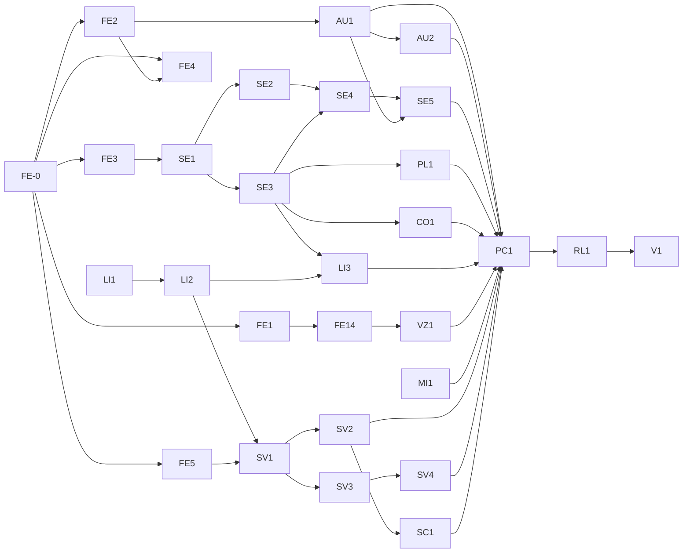

# KoalaAmp — Build Tickets (Qt edition)

**Format:** ticket = `ID · Title` with *Story*, *Tasks*, *Acceptance*, *Depends*, *Est.* (focused days, one experienced C++ dev). Spikes are timeboxed.

**Per-ticket briefs:** fifteen tickets have expanded contracts in [`tickets/`](tickets/) — the AI-consumable task files (story, tasks, checkable DoD, out-of-scope, reference paths). Template: `tickets/_template.md`. This index remains the master for sequencing, estimates, and dependencies; expand remaining tickets from the template at pickup time.

| Expanded | File |
|---|---|
| FE-0 bootstrap (repo+CI) | `tickets/FE-0-bootstrap.md` |
| FE-1 mask+GL spike | `tickets/FE-1-masked-gl-window.md` |
| FE-2 libvlc callbacks+EQ | `tickets/FE-2-libvlc-callbacks-eq.md` |
| FE-5 koalapaw port skeleton | `tickets/FE-5-koalapaw-port-skeleton.md` |
| FE-14 projectM-in-Qt spike | `tickets/FE-14-projectm-qt.md` |
| SE-1 WSZ loader | `tickets/SE-1-wsz-loader.md` |
| SE-2 main window | `tickets/SE-2-main-window.md` |
| SE-5 EQ window | `tickets/SE-5-eq-window.md` |
| AU-1 DSP + EQ | `tickets/AU-1-dsp-eq.md` |
| LI-3 library UI + smart views | `tickets/LI-3-library-ui.md` |
| VZ-1 visualizer window | `tickets/VZ-1-visualizer.md` |
| MI-1 migration wizard | `tickets/MI-1-migration.md` |
| SV-1 Jellyfin port | `tickets/SV-1-jellyfin-port.md` |
| SV-2 Jellyfin playback | `tickets/SV-2-jellyfin-playback.md` |
| SV-4 Plex playback | `tickets/SV-4-plex-playback.md` |

**Sequencing:** M0 → M1 → M2 → M3 (v1.0 ships after M3). M4+ = Phase 3. Server tickets are *ports* of the maintainer's koalapaw Android code — wire contracts are field-tested; the work is transliteration.

---

## M0 — Spikes & Skeleton (≈ 2 wks)

### FE-0 · Bootstrap repo & CI — *2d*
- **Tasks:** Qt 6.12 LTS CMake superbuild (app + interop + tests); CI matrix win-x64/msvc, linux-x64/gcc, mac-arm64/clang; vcpkg/deps for Qt, libvlcpp, taglib, projectM, sqlite; license-audit script (denylist GPL in direct links).
- **Acceptance:** `llama5` shows an empty frameless window on all 3 OSes; CI green; `LICENSES.md` inventory generated (Qt LGPLv3, libvlc LGPL, projectM LGPL, TagLib LGPL/MPL, miniaudio MIT-0, SQLite pd).
- **Depends:** —

### FE-1 · Spike: masked frameless window + QOpenGLWidget — *3d*
- **Tasks:** `Qt::FramelessWindowHint` + `setMask(region.txt-style polygon)`; child `QOpenGLWidget` (spinning triangle) in the *same* toplevel; verify on Win10/11 (SetWindowRgn + swapchain coexistence), X11 (XShape), macOS (CALayer mask + app hit-test); note input clipping per OS; check masked window under XWayland on a Wayland session.
- **Acceptance:** report in `docs/spikes/masked-gl-window.md` per OS: pixels clipped to polygon; clicks outside rejected (or hit-test fallback engaged); GL renders inside mask; decision recorded for viz-window hosting (masked vs own toplevel).
- **Depends:** FE-0

### FE-2 · Spike: libvlc callbacks + EQ rule + latency — *3d*
- **Tasks:** raw libvlc C API; `libvlc_audio_set_callbacks` → ring buffer → miniaudio sink; measure p95 latency + 30-min xruns on WASAPI/CoreAudio/ALSA; **verify the EQ interaction: enable `libvlc_media_player_set_equalizer` mid-session and assert the callback PCM changes (filters are upstream)** → encode the "never native-EQ in DSP mode" rule as a runtime assertion; measure bit-perfect stop/start seam for gapless decision.
- **Acceptance:** latency characterized per backend (the ≤50ms target proved unmeetable — engine floor is libvlc's decoded block; measured + recorded either way); zero xruns/30min; EQ-upstream behavior documented with a test; seam measurement recorded.
- **Depends:** FE-0

### FE-3 · Spike: WSZ loader renders base-2.91 — *2d*
- **Tasks:** ZIP open; port Webamp `skinSprites` coordinate table; QPainter blits of main/titlebar/cbuttons/posbar/volume/numbers/text; nearest-neighbour transform.
- **Acceptance:** main window pixel-diffs ≤ 0.1% vs Webamp's render of `base-2.91.wsz` at 1×; button states toggle.
- **Depends:** FE-0

### FE-14 · Spike: projectM in QOpenGLWidget — *2d*
- **Tasks:** follow projectM's own Qt frontend pattern: create in `initializeGL`, `projectm_pcm_add_float` + `projectm_opengl_render_frame` in `paintGL`; noise PCM; one preset; check FPS at 1080p; test inside a *masked* toplevel and in an unmasked one.
- **Acceptance:** preset animating ≥ 55fps on Win+Linux (+mac GL); masked-window interaction result recorded; chosen hosting mode documented.
- **Depends:** FE-1

### FE-5 · Spike: koalapaw jellyfin-api port skeleton — *3d*
- **Tasks:** port `JellyfinApi`/`AuthInterceptor`/`UdpServerDiscovery` core (auth, discovery, one browse call) to C++ over libcurl + JSON DOM; run against a live Jellyfin 10.10/10.12 container.
- **Acceptance:** authenticate (MediaBrowser headers only), UDP-discover, list music albums from C++ in a test binary; fixtures recorded.
- **Depends:** FE-0

### FE-4 · Play an MP3 end-to-end — *2d*
- **Tasks:** file → queue → libvlc → miniaudio sink; volume; seek; EndReached → next; Media disposal discipline.
- **Acceptance:** MP3/FLAC/OGG play on 3 OSes; 200 track changes leak-free (ASAN clean).
- **Depends:** FE-2

---

## M1 — Classic Skin Engine & Core Playback (≈ 7 wks)

### SE-1 · WSZ loader complete — *4d*
- **Tasks:** all canonical files (spec §5.1) incl. RLE8/palette BMP handling; lenient text parsers; case-insensitive names; fallbacks; folder skins; skin DB; drag-drop.
- **Acceptance:** golden corpus (30 skins incl. RLE8-heavy, missing `eq_ex`, 1-bit) — no crashes; parser unit tests 100% grammar; corpus inventory with licenses.
- **Depends:** FE-3

### SE-2 · Main window full control set — *7d*
- **Tasks:** titlebar (menu/shade/buttons/clutterbar), posbar, volume/balance sliders (28/27 frames, mono-center), shuffle/repeat, transport buttons + eject, monoster indicators, KBPS/KHZ, numbers display (incl. minus digits), `text.bmp` font + marquee, 75-bar spectrum & osc from PcmTap.
- **Acceptance:** golden screenshots per state match baselines; interaction parity checklist 100%.
- **Depends:** SE-1, FE-4

### SE-3 · Playlist editor (classic) — *6d*
- **Tasks:** `pledit.bmp`+`pledit.txt` theming; list render; segment tiling resize (25px); windowshade bar; drag-reorder; multi-select; right-click verbs; J jump dialog + queue; scrollbars; ATF titles.
- **Acceptance:** 10k entries scroll 60fps; queue semantics behavioral tests pass; ATF default titlefmt renders.
- **Depends:** SE-1, FE-4

### SE-4 · Window manager: snapping/docking/shade/z-order — *4d*
- **Tasks:** spec §5.3; 10px snap tolerance; dock groups; group drag; keep-on-top; layout persistence; **Wayland → XWayland launch wrapper + fallback**; polygon hit-test as macOS input mask.
- **Acceptance:** scripted drag tests snap/detach/group-move on all OSes; layout restore exact; region.txt shapes behave (Win+X11 real masks; macOS layer mask + hit-test; Wayland via XWayland).
- **Depends:** SE-2, SE-3

### SE-5 · Equalizer window (classic) — *4d*
- **Tasks:** `eqmain.bmp` (11 grooves, 61-frame thumbs, ON/AUTO/RESET, preset panel) + `eq_ex.bmp` shade; preamp + 10 sliders bound to DSP (0-64, 31=0dB); preset list (18 named + user); `.eqf` load/save from this window; auto-load-EQ indicator; snaps with SE-4.
- **Acceptance:** golden screenshots per state; slider drag updates biquads within one block; preset switch glitch-free; `.eqf` round-trips.
- **Depends:** SE-1, SE-4, AU-1

### AU-1 · DSP pipeline + 10-band EQ — *5d*
- **Tasks:** spec §4.1 chain; biquad bank (Winamp + Constant-Q); preamp; limiter; `.eqf` parse/write + `winamp.q1` import; auto-load per track; **no-native-EQ assertion on the callbacks path** (FE-2 rule); golden transfer-function tests.
- **Acceptance:** transfer functions match reference curves; `.eqf` byte-compat round-trip; latency budget held; allocation-free steady state; runtime assertion never fires.
- **Depends:** FE-2, FE-4

### AU-2 · Gapless + ReplayGain — *4d*
- **Tasks:** scheduler prefetch 10s; sample-exact boundary (DSP) or measured seam (bit-perfect, FE-2 data); RG modes + preamp + clip prevention + −6dB fallback; R128 tags.
- **Acceptance:** concert-rip seam < 20ms DSP / < 50ms bit-perfect; RG ±6dB tags measure ±0.5dB applied; no clipping with prevent on.
- **Depends:** AU-1

### PL-1 · Playlist persistence + formats — *3d*
- **Tasks:** M3U/M3U8 writer (byte-exact `#EXTINF`), reader (BOM, relative paths); PLS; B4S; XSPF; autosave; ML `playlists.xml`.
- **Acceptance:** round-trip fixtures (unicode, long paths, URLs); M3U8 byte-identical to Winamp writer on fixtures; fuzz 100 malformed files no crash.
- **Depends:** SE-3

---

## M2 — Library & Local Experience (≈ 5 wks)

### LI-1 · Scanner + TagLib pipeline — *5d*
- **Tasks:** spec §7.1; TagLib field set; art extraction; duration/bitrate pre-scan; incremental rescan; FS watcher + debounce; ignore files; skinned progress UI.
- **Acceptance:** 10k files < 5min cold / < 30s warm; edge-corpus (id3v1/v2.2-2.4, apev2, vorbis, flac, mp4, malformed) no crashes, ≥99% field mapping; watcher ≤ 5s.
- **Depends:** FE-4

### LI-2 · SQLite schema + FTS5 search — *3d*
- **Tasks:** schema + FTS; search service; browse queries; 100k generator + perf harness.
- **Acceptance:** search p95 < 100ms @100k; browse p95 < 200ms; WAL; migration dry-run test.
- **Depends:** LI-1

### LI-3 · Library UI (skinned) + smart views — *5d*
- **Tasks:** media-library window (gen bitmaps + fallback design); artist/album tree; track grid; filters; smart views (grammar parser→SQL; default set); rating stars + hotkeys; playcount/lastplayed hooks.
- **Acceptance:** grammar unit tests (all operators, `&&`/`||`/`!`, `[1 week ago]`); defaults correct vs SQL reference; rating writes DB.
- **Depends:** LI-2, SE-3

### VZ-1 · projectM visualizer window — *5d*
- **Tasks:** productionize FE-14: VisualizerWindow with skin chrome; preset browser overlay; cycling; hotkeys; fullscreen; texture pack + per-preset images; fallback hosting per FE-14 findings.
- **Acceptance:** 500-preset nightly: no crash/hang (10s timeout), ≥ 55fps p95 at 1080p on GTX1050-class; switch < 300ms; 3 OSes.
- **Depends:** FE-14, FE-4

### CO-1 · Platform integration pass 1 — *4d*
- **Tasks:** QSystemTrayIcon menu; global hotkeys (QHotkey/platform registration) with gen_hotkeys default set + conf UI; file assoc + enqueue/play verbs (registry/plist/desktop); single-instance local-socket IPC; CLI args.
- **Acceptance:** double-click file enqueues into running instance on all OSes; hotkeys work unfocused; second launch focuses existing.
- **Depends:** SE-3

### MI-1 · Winamp migration wizard — *4d*
- **Tasks:** detect `%APPDATA%/Winamp`; NDE reader (field IDs 0-41) read-only; path join rules; import ratings/playcount/lastplay/dateadded/RG/bpm + playlists + `winamp.ini` (volume/EQ/skin/titlefmt) + `winamp.q1` + `winamp.bm`; unmatched report.
- **Acceptance:** fixture NDE db imports 100% fields; idempotent; unmatched < 5%; wizard UI skinned.
- **Depends:** LI-3, AU-1, PL-1

---

## M3 — Servers, Scrobbling, v1.0 Polish (≈ 4 wks — reduced by koalapaw port)

### SV-1 · Jellyfin client port (auth/browse/search) — *4d*
- **Tasks:** complete the FE-5 port: gateway interfaces; music windows (albums/artists/A-to-Z); search; artwork caching; connection manager UI; token refresh on 401; QuickConnect optional.
- **Acceptance:** vs Jellyfin 10.10 + 10.12 containers: auth, browse, search, art; fixtures recorded for CI; MediaBrowser headers only (assert: no `X-Emby-Token`, no `api_key` anywhere, incl. WS handshake).
- **Depends:** LI-2, FE-5

### SV-2 · Jellyfin playback + progress + remote control — *3d*
- **Tasks:** direct-play streams via libcurl→libvlc callbacks (header auth, Range); HLS fallback decision; RG from `NormalizationGain`; Sessions/Playing reports (10s + events, correct PlayMethod); WS remote control (Play/Playstate/GeneralCommand, KeepAlive).
- **Acceptance:** E2E: play/pause/seek reported (dashboard ±5s); remote control from another client works; transcode fallback triggers when codec forced-unsupported.
- **Depends:** SV-1, AU-1

### SV-3 · Plex client port (auth/browse) — *3d*
- **Tasks:** port koalapaw `plex-api`: PIN/link flow + browser; legacy token for PMS; GDM discovery; music sections browse (paging); search; artwork.
- **Acceptance:** E2E vs PMS 1.4x container: auth (incl. 2FA), browse, art; recorded fixtures; expired-token → re-auth prompt.
- **Depends:** SV-1

### SV-4 · Plex playback + progress + ratings — *2d*
- **Tasks:** direct play Part URLs + Range; client-profile headers; `/:/timeline`; `/:/rate`; `/:/scrobble`; version-gate + graceful errors.
- **Acceptance:** E2E: play with seek; timeline reflects in PMS; 4-star rating visible in Plex web; regression suite pinned to fixture version.
- **Depends:** SV-3, AU-1

### SC-1 · Scrobbling — *3d*
- **Tasks:** Last.fm desktop auth; now-playing + batched scrobbles; ListenBrainz submit with MBIDs; anti-double-scrobble mode setting.
- **Acceptance:** sandbox round-trip (scrobble + love); offline queue retries; mode matrix tests.
- **Depends:** SV-2

### PC-1 · Performance & polish — *4d*
- **Tasks:** cold start < 2s; memory < 350MB @100k lib; layout/queue/position restore; crash-safe settings; About/licenses dialog (LGPL notices + Qt/relinking offer); updater check.
- **Acceptance:** CI perf smoke job; cold/warm numbers documented; licenses dialog complete.
- **Depends:** all above

### RL-1 · Legal & release readiness — *2d*
- **Tasks:** counsel review (license inventory, naming, trademark descriptor); final product name (not JellyAmp/Winamp-anything); Plex Interfacing-Software notices + opt-out if commercial; default skin = original/cleared artwork; skin-corpus download linking; privacy notice; **Qt LGPLv3 compliance checklist** (dynamic linking, relinking offer, notices).
- **Acceptance:** sign-off in `docs/legal/signoff-v1.md`; audit script finds zero Nullsoft/WCL-derived assets.
- **Depends:** PC-1

### V1-0 · v1.0 Release — *3d*
- **Tasks:** packaging per-OS (installer, dmg+notarize, AppImage/Flatpak); release notes; golden+perf suites green; known-issues (Wayland-XWayland note, Plex best-effort).
- **Acceptance:** signed installers run from clean profile on 3 OSes; smoke checklist executed.
- **Depends:** RL-1

---

## M4+ — Phase 3 (post-v1.0; unscheduled)

- MK-1 Modern-skin research: Maki VM prototype on Webamp's bytecode spec — timebox 3 wks, go/no-go report.
- MK-2 WAL container + XML layout + widget subset.
- AV-1 AVS experiment: libavs (BSD) behind the visualizer interface; 64-bit port scoping.
- TR-1 Trackers: libopenmpt input plugin.
- DS-1 Device sync (MTP) spike.
- CP-1 C++ plugin SDK public surface (spec §10).

---

## Dependency graph

## Sizing summary

| Milestone | Focus | Days |
|---|---|---|
| M0 | spikes + skeleton (incl. koalapaw port skeleton) | 17 |
| M1 | skins + core playback (incl. EQ window) | 37 |
| M2 | library + local UX | 26 |
| M3 | server ports + polish + ship | 25 |
| **Total v1.0** | | **~105 focused days** |

(Qt's skin-engine C++ work costs ~10 days over the Avalonia plan; the koalapaw port *saves* ~12 days of greenfield server work.)
